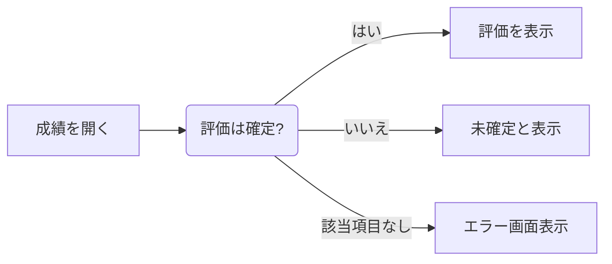
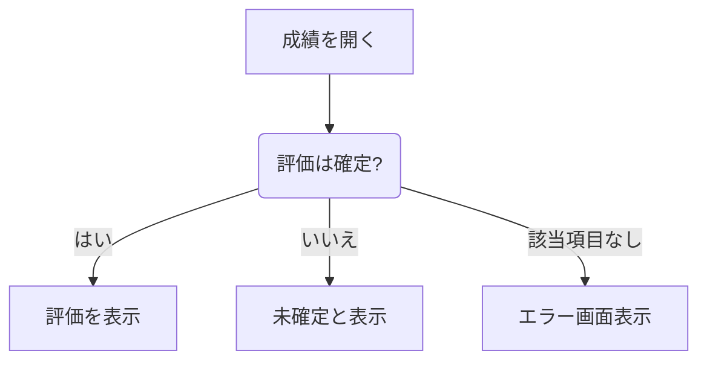
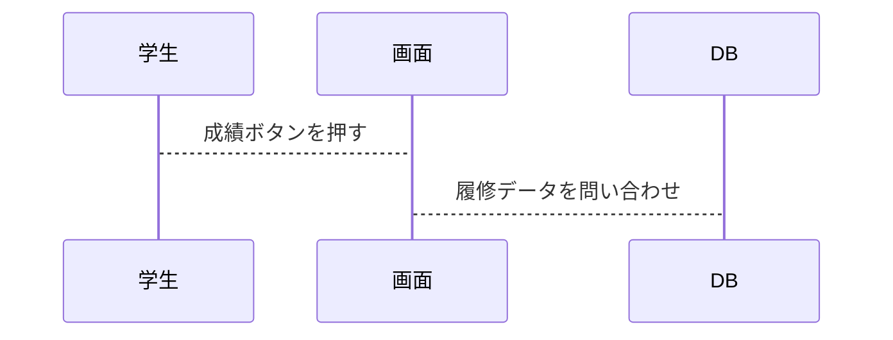

# システム設計Ⅰ
## 次の見出し

- 要件定義
- 外部設計

この授業は**ここ**が重要です

>引用-(>)（あるサイト）から調べたことを示すためのやつ

[いわきコンカレ](https://www.iwaki-cc.ac.jp)


表のやつ↓
|項目名|型|桁数|必須|
|---|---|---:|:---:|
|学籍番号|文字|5|〇|
|科目名|文字|60|〇|
|素点|数値|3||

---は左寄せ---:は右寄せ:---:は中央ぞろえ
表はそろってなくても動くらしい

コードブロック（そのまま見せたいやつ、プログラムソフト名を書くと対応してくれるみたい）↓
```sql
26110426
SELECT * FROM 履修
WHERE 評価 IS NULL;
```
```java
public class helloworld
public static void main(String args())
    System.out.println("Hello,World");
```
`（バッククウォート、@+Shiftで打てる）
- [x] 機能一覧を作る
- [ ] 非機能要件を書く
- [ ] レビューを受ける



[]で項目の中身を書ける？
||で分岐条件を書ける？
-->は流れを作るのに必須みたい
LRは左から右につなげるということらしい
TD　上から下、トップダウン



->>は依頼(実線)-->>は応答(破線)
上から下に流れる